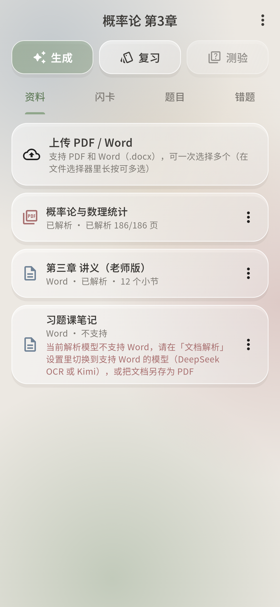
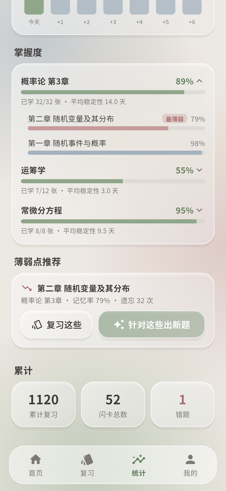
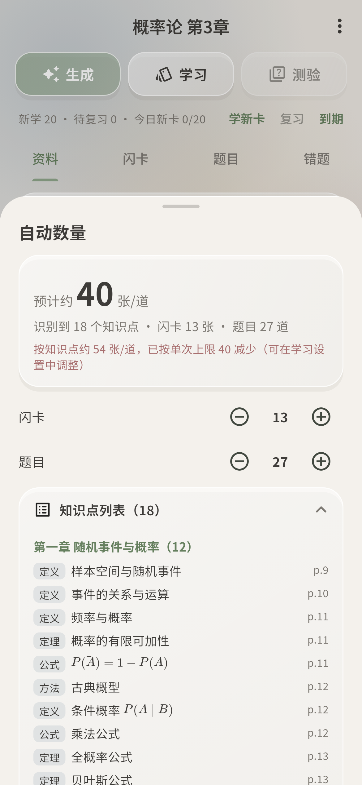
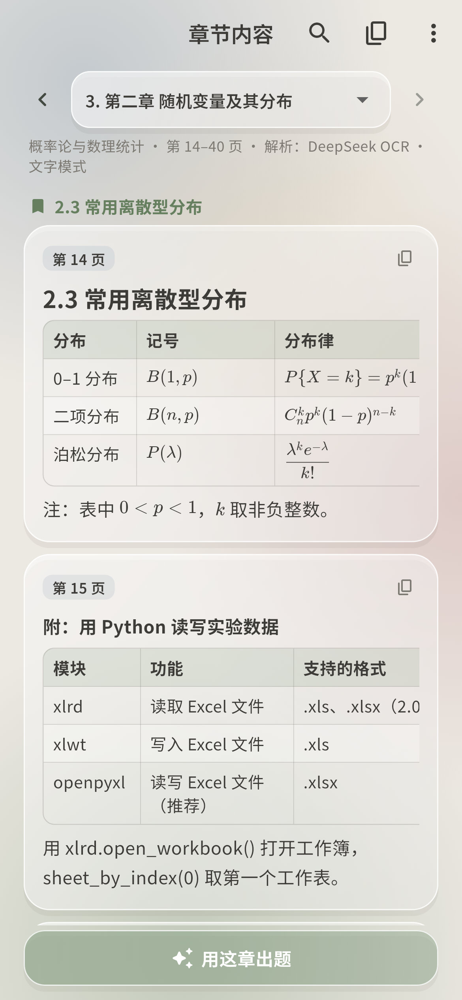
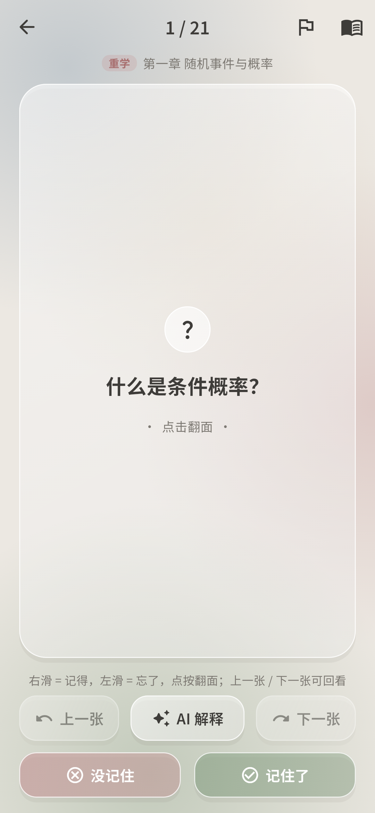
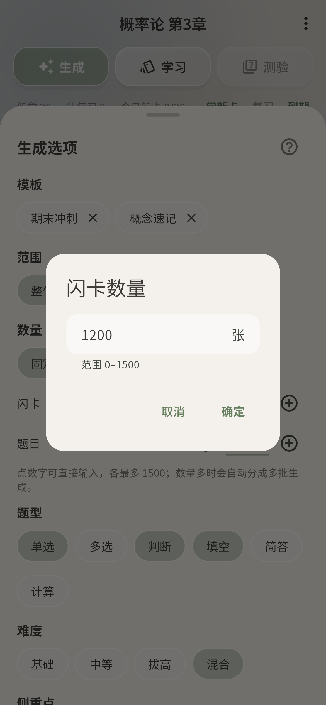

<div align="center">


# AI Flashcards

**Turn your textbooks into flashcards and quizzes, and remember them with spaced repetition.**

[](https://github.com/HenryHam88/ai-flashcards/releases/latest)
[](https://github.com/HenryHam88/ai-flashcards/releases)
[](LICENSE)
[](#download)
[](https://flutter.dev)

[简体中文](README.md) | **English**

</div>

AI Flashcards (闪卡刷题) is an open-source study app for Android, Windows, macOS, and Linux that turns PDF, Word, or TXT textbooks into flashcards and quizzes, then schedules reviews with the FSRS algorithm. It is similar to Anki, but can use AI to generate cards and questions from your textbooks automatically. Formulas are typeset like a textbook, and all your study data stays on your own device.

> [!NOTE]
> The app interface is currently available in Simplified Chinese only.

## Screenshots

<table>
  <tr>
    <td align="center"><br><sub>Projects</sub></td>
    <td align="center"><br><sub>Flashcard review</sub></td>
    <td align="center"><br><sub>Quiz</sub></td>
    <td align="center"><br><sub>AI explanation</sub></td>
  </tr>
  <tr>
    <td align="center"><br><sub>Study data</sub></td>
    <td align="center"><br><sub>Mistake book</sub></td>
    <td align="center"><br><sub>Documents</sub></td>
    <td align="center"><br><sub>Parsing settings</sub></td>
  </tr>
</table>

<details>
<summary>More screenshots</summary>

<table>
  <tr>
    <td align="center"><br><sub>Settings</sub></td>
    <td align="center"><br><sub>Explanation history</sub></td>
    <td align="center"><br><sub>Dark mode</sub></td>
    <td align="center"><br><sub>Onboarding</sub></td>
  </tr>
  <tr>
    <td align="center"><br><sub>Review new cards</sub></td>
    <td align="center"><br><sub>Mastery and weak spots</sub></td>
    <td align="center"><br><sub>Automatic count</sub></td>
    <td align="center"><br><sub>Chapter content</sub></td>
  </tr>
  <tr>
    <td align="center"><br><sub>In-app help</sub></td>
    <td align="center"><br><sub>Help article</sub></td>
    <td align="center"><br><sub>Tables</sub></td>
    <td align="center"><br><sub>LaTeX text formatting</sub></td>
  </tr>
  <tr>
    <td align="center"><br><sub>TXT files</sub></td>
    <td align="center"><br><sub>New vs. due</sub></td>
    <td align="center"><br><sub>Card badges</sub></td>
    <td align="center"><br><sub>Due by day</sub></td>
  </tr>
  <tr>
    <td align="center"><br><sub>Re-parse a chapter</sub></td>
    <td align="center"><br><sub>Concurrency</sub></td>
    <td align="center"><br><sub>Type a count</sub></td>
  </tr>
</table>

</details>

## Features

**Documents and generation**
- PDF, Word (.docx / .doc), and TXT, batch import with per-file progress
- TXT files are read on your device (offline, free) with automatic UTF-8 / UTF-16 / GBK detection, split into sections at paragraph breaks, then chaptered as usual
- Scanned PDFs are supported; formulas are kept as LaTeX
- Automatic chapter detection (bookmarks, table of contents, heading formats, with AI as a fallback), plus a manual chapter editor
- Chapter content viewer: read the parsed text of each chapter page by page with textbook-style formulas, switch chapters, search with highlighting, copy, see which parser produced it, and generate from that chapter in one tap
- Re-parse just one chapter (with a different engine if you like), compare old and new text page by page before replacing it, and undo the last re-parse; view or re-analyze a chapter's knowledge points
- Generate from the whole document, selected chapters, or a page range; choose count (tap the number to type it, up to 1500 cards and 1500 questions, split into batches automatically), question types, difficulty, and focus
- Adjustable concurrency (1–2500, default 4): PDF OCR batches, knowledge-point analysis, and generation batches run in parallel under one shared request limit, with automatic backoff on HTTP 429
- "Automatic (by knowledge point)" count: the knowledge points in the selection are listed first, then about 1 card and 1–3 questions per point (by difficulty) are proposed as "about N items" for you to confirm; a per-generation cap keeps count and cost in check
- Question types: single choice, multiple choice, true/false, fill-in-the-blank, short answer, calculation
- Every card and question links back to its source in the original text
- Automatic quality checks after generation: source matching, formula rendering, multiple-choice validity, and near-duplicate detection; failing items get one batched AI fix or are dropped, with a summary such as "30 generated, 2 auto-fixed, 3 duplicates removed"
- Optional "review before adding": new items wait in an inbox where you can accept, edit, delete, or have AI rewrite them
- Flag any card or question as wrong, too easy, duplicate, out of scope, or unclear; future generation avoids those problems

**Study and AI**
- Learning section: generate a mind map per chapter on demand (edit nodes, expand or collapse, save as an image)
- AI study buddy: chat over selected chapters or page ranges, grounded in the source text, and save a conversation as a note; attach PDF, Word, TXT, or images (up to 5 per conversation); source text cap is 60,000 characters
- Knowledge-point notes: photos, your own understanding, AI explanations, related questions, and page-referenced quotations; export one note or all notes as PDF
- Favorites: star knowledge points, flashcards, and questions, then review or practice them from the project page or the home Favorites entry
- Web search is on by default in "deep search" mode, with clickable reference links under the answer; flashcard and quiz generation never go online
- Multiple model providers (我的 → AI 模型): add DeepSeek, Qwen, Zhipu, Kimi, Doubao, SiliconFlow, OpenRouter, Ollama, and others; paste a key, pull the model list, then pick; generation, AI explanations, and the study buddy can use different models, or the latter two can follow the generation model
- Answers stream as they are generated and can be stopped at any time; study-buddy and explanation chats can be copied

**Review and practice**
- FSRS spaced-repetition scheduling with four grades (Forgot / Fuzzy / Got it / Easy); you can go back and change the previous card's grade
- New and due cards are counted separately (Anki-style): "Learn new", "Review", and "Study all" (due reviews first, then new); 20 new cards a day by default, with "10 more today"; each card is badged new / review / relearn
- Due by day: see which cards come due on which day (including overdue), filter by project, and review them right away
- Objective questions are graded automatically; short-answer and calculation questions are graded by AI
- AI explanations grounded in the source text, with follow-up questions; every explanation is kept in a searchable history you can star and continue
- Mistake book: wrong answers are collected automatically, filterable by project, with new questions generated for weak points; mistakes can also be exported as a PDF (answer after each question or all at the end, optional explanations and last answers)
- Study data: daily overview (reviews, accuracy, time, streak), a six-month heatmap, a due forecast for 7 / 30 / 90 days or everything (weekly or monthly bars beyond 30 days; tap a bar to see that day's cards), and mastery per project and chapter
- Weak-spot suggestions based on lapses, mistakes, and recall, with one tap to review them or generate new questions targeting them
- Study settings: daily new / review limits, FSRS desired retention, day start time
- Daily review reminder (local notification, no network needed)

**Data**
- Export everything to a single `.afcbak` backup and restore it on a new phone, including review progress, mistakes, and explanation history
- Integrity check before import; choose "Overwrite" (a safety backup is made first) or "Merge" (keeps the more recent progress for each card)
- Export a single project to share with classmates, with or without your own progress
- Optional weekly automatic backup, keeping the latest 3
- Export to Obsidian / Notion: notes, AI study-buddy and explanation chats, favorites, and mistakes as a Markdown zip (mistakes also as a CSV you can import as a Notion database)
- "Save to folder" opens the system picker so you choose where the file goes
- Optionally offload large files to Aliyun OSS, Tencent COS, or S3-compatible storage to free space on the phone; files download again when you open them. Cloud credentials are never included in backups.

**Experience**
- Full LaTeX typesetting and Markdown formatting; tables recognized in your material (formulas included) are shown as real, horizontally scrollable tables; LaTeX text commands outside formulas (`\texttt`, `\textbf`, itemize, tabular, …) are displayed as proper formatting
- Calm Morandi color palette with a glass-style interface, plus dark mode
- Built-in help (我的 → 使用帮助, in Chinese): step-by-step guides for every feature plus an FAQ, searchable and available offline; the **?** button on the key, chapter editor, and generation screens opens the matching guide
- Adjustable text and formula size; reduce motion and haptics toggles
- Review progress is saved automatically

## Download

Get the latest version from [Releases](https://github.com/HenryHam88/ai-flashcards/releases/latest):

### Android

| Package | Devices |
| --- | --- |
| `ai-flashcards-<version>-arm64-v8a.apk` | **Most phones (recommended)** |
| `ai-flashcards-<version>-armeabi-v7a.apk` | Older 32-bit devices |
| `ai-flashcards-<version>-x86_64.apk` | Emulators and x86 tablets |

Requires Android 7.0 or later. Allow "Install unknown apps" on first install. New versions install over the old one and keep your data.

<details>
<summary>Signing certificate fingerprint</summary>

```
SHA-256: f5:ec:04:9f:25:ef:21:59:36:28:23:59:4a:08:49:46:f5:66:6d:cc:54:35:19:b9:9a:e1:d0:2f:be:a1:0d:59
```

Verify with `apksigner verify --print-certs <apk>`.
</details>

### Desktop

| Package | System |
| --- | --- |
| `ai-flashcards-<version>-windows-x64.zip` | Windows 10 / 11 (64-bit) |
| `ai-flashcards-<version>-macos.zip` | macOS 12 or later (Apple silicon and Intel) |
| `ai-flashcards-<version>-linux-x64.tar.gz` | 64-bit Linux (Ubuntu 22.04, Debian 12, Fedora 38 or later, etc.) |

The desktop app has the same features as the phone app; move data between them with a backup file. The desktop builds are not signed with a paid developer certificate yet, so the system asks for confirmation the first time:

- **Windows**: unzip and double-click `ai_flashcards.exe`. If you see "Windows protected your PC", click **More info → Run anyway**.
- **macOS**: unzip, drag 闪卡刷题 into Applications, then **right-click it → Open → Open**. If there is no Open button (macOS 15 or later), double-click it once, then go to **System Settings → Privacy & Security** and click **Open Anyway** at the bottom. After that it opens normally.
- **Linux**: extract and run `ai_flashcards` in the folder; run `./install-desktop-entry.sh` to add it to your app menu. Needs GTK 3 and libsecret (included in most desktop distributions).

To update, download the new version and replace the old files. Your data lives in the system's app data folder and is kept.

## Quick start

1. Create an API key on the [DeepSeek Platform](https://platform.deepseek.com/) (or another supported provider).
2. In the app, open **我的 (Me) → AI 模型 (AI models)**, add a provider, paste the key, and tap 拉取模型 (Pull models) or 测试连接 (Test connection).
3. Create a project, upload a textbook, and tap 生成 (Generate) once parsing finishes.

> [!TIP]
> Generation, AI explanations, and the study buddy can each use a different model. The API is OpenAI-compatible, so you can also use Qwen, Kimi, and similar services.

## Supported parsing providers

Choose in **我的 → 文档解析（PDF / Word）** (Me → Document parsing):

| Provider | PDF | Word (.docx / .doc) | Scanned | Cost |
| :-- | :-: | :-: | :-: | :-- |
| DeepSeek OCR (default) | ✓ | ✓ | ✓ | Per page |
| Kimi file extraction | ✓ | ✓ | — | Currently free |
| Local text layer | ✓ | — | — | Free, offline |

TXT files ignore this setting and are always read on your device, free and offline.

## Privacy and data

- Documents, cards, mistakes, and review history are stored only on your device. The project runs no servers.
- API keys are kept in the system secure storage (Android Keystore).
- Document content is sent only to the providers you configure; "Local text layer" mode never goes online. TXT files are read on your device and are not uploaded.
- Backups exclude API keys by default; they are included only if you turn on "包含 API 密钥" (backups are not encrypted, so keep them private). Cloud-storage credentials are never included in backups.

## FAQ

<details>
<summary><b>Is it free?</b></summary>

The app is free and open source. Parsing and generation use your own API key and are billed by that provider. Results are cached, so the same content is never billed twice.
</details>

<details>
<summary><b>Uploading Word says "the current parsing model does not support Word"?</b></summary>

Local text-layer mode reads PDFs only. Switch to DeepSeek OCR or Kimi in parsing settings, or save the document as PDF.
</details>

<details>
<summary><b>How do I move my data to a new phone?</b></summary>

On the old phone open **我的 → 导出 / 导入数据 → 导出数据** and save or share the `.afcbak` file (turn on "include original PDF / Word" if you want to re-parse or view source pages later). On the new phone choose **导入数据 → 覆盖当前数据** on the same page. API keys are not migrated by default.
</details>

<details>
<summary><b>A formula looks wrong. What can I do?</b></summary>

Ask for a rewrite in the card's AI explanation, or mark the question as "AI 出错了" (AI made a mistake) in the quiz.
</details>

**Known limitations**

- Generation and grading quality depends on the model you choose; double-check important content against the source.
- With Kimi, source page numbers for PDFs may be imprecise.
- Chapters of unusually formatted books may be detected incorrectly; adjust them in the chapter editor or let AI re-split them.
- Move data between your phone and computer with a backup file; there is no real-time sync.

## Build from source

Requirements: Flutter 3.50 (stable), Android SDK, JDK 17.

```bash
git clone https://github.com/HenryHam88/ai-flashcards.git
cd ai-flashcards
flutter pub get
flutter test
flutter build apk --release --split-per-abi
```

Build the desktop app on the matching system: `flutter build windows`, `flutter build macos`, or `flutter build linux` (Linux needs `clang cmake ninja-build pkg-config libgtk-3-dev libsecret-1-dev`). When a version tag is pushed, GitHub Actions builds the three desktop packages and attaches them to that release.

Release signing reads `android/key.properties` (or the file pointed to by `AI_FLASHCARDS_KEY_PROPERTIES`); without it, the debug key is used.

<details>
<summary>Configure release signing</summary>

1. Generate a keystore the first time you publish (keep using the same one; losing it means you cannot install over older official builds):

   ```bash
   keytool -genkeypair -v -keystore ~/keys/ai-flashcards-release.jks \
     -alias ai-flashcards -keyalg RSA -keysize 4096 -validity 10000
   ```

2. Copy `android/key.properties.example` to `android/key.properties` and fill in the path, alias, and both passwords.
   `key.properties`, `*.jks`, and `*.keystore` are in `.gitignore` — **do not commit them**. Keep a separate backup of the keystore.
3. Run `flutter build apk --release --split-per-abi`, then check the certificate fingerprint with `apksigner verify --print-certs <apk>` against the one published above.
   An APK signed with a different certificate cannot be installed over the official release.
</details>

## Feedback

Questions and suggestions are welcome in [Issues](https://github.com/HenryHam88/ai-flashcards/issues). Pull requests are welcome too — see [CONTRIBUTING.md](CONTRIBUTING.md). Version history is in the [CHANGELOG](CHANGELOG.md).

## License

Released under the [MIT License](LICENSE). The Noto Sans SC font used in tests is licensed under the [SIL Open Font License 1.1](test/fonts/OFL.txt).
