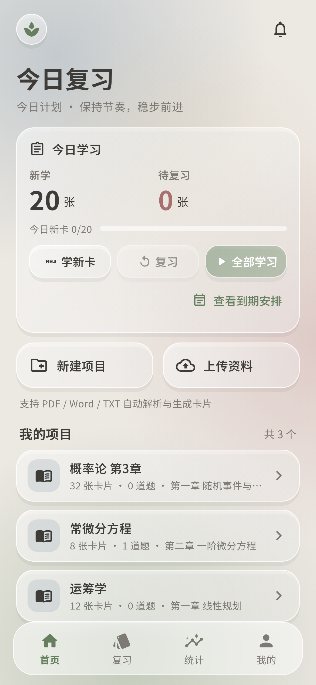
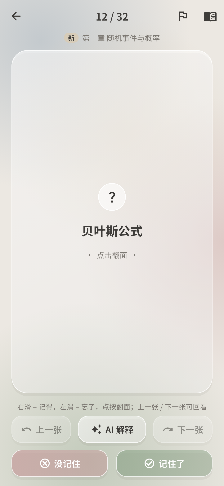
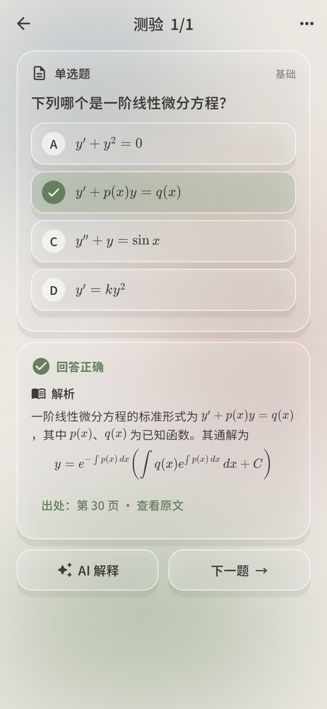
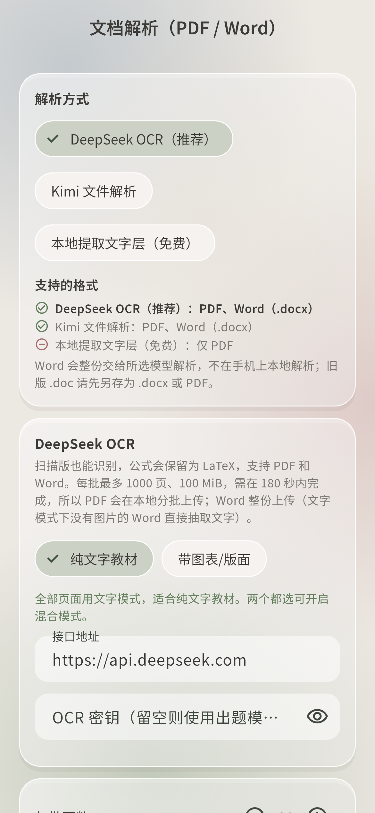
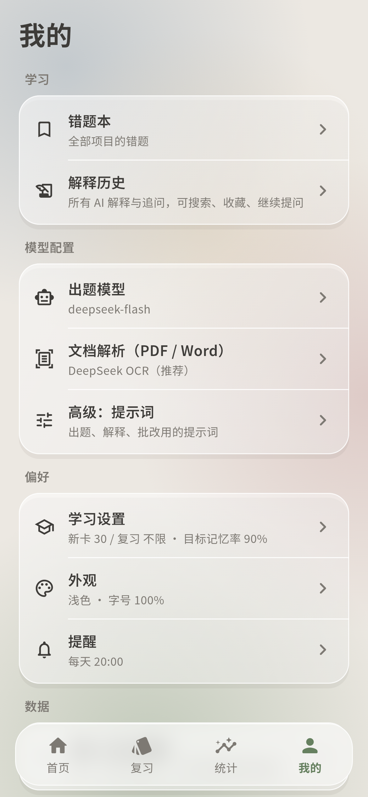
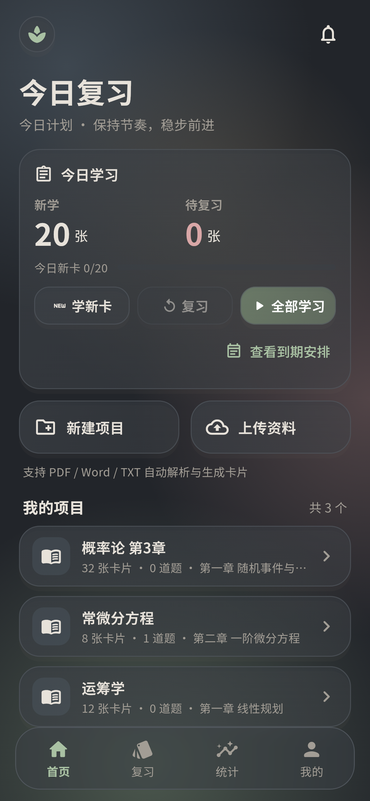
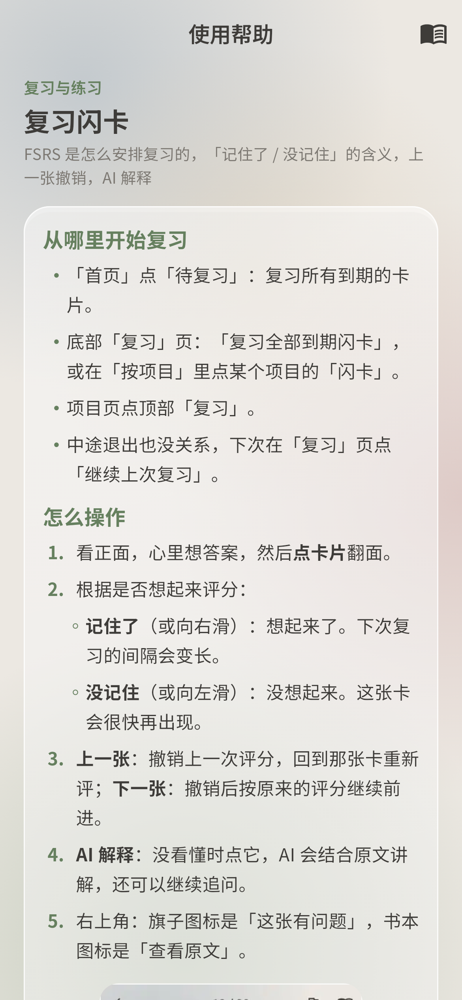
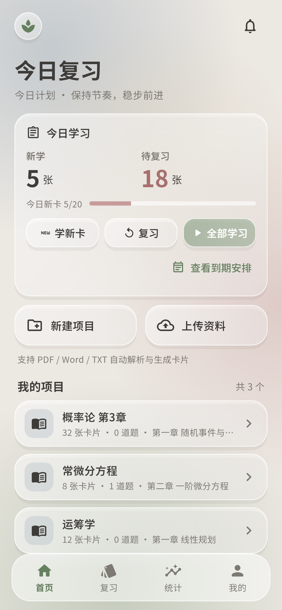
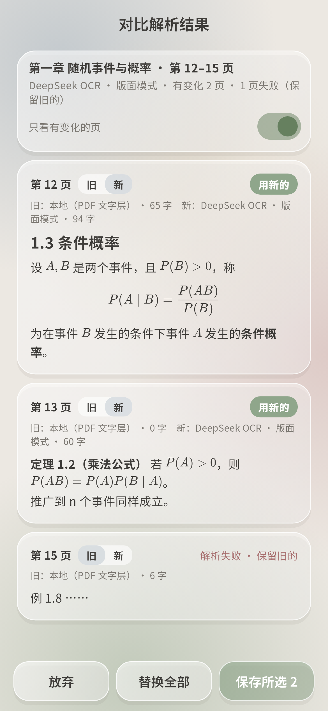
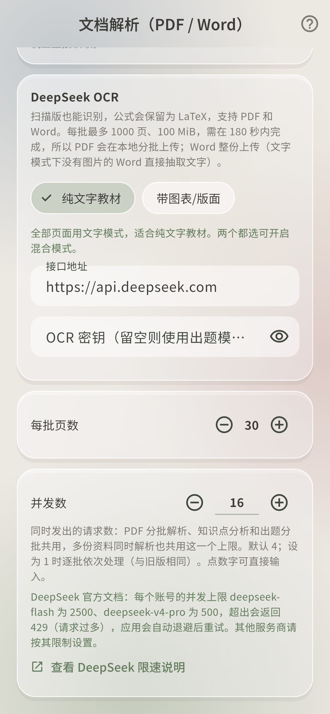

<div align="center">


# AI Flashcards

**Turn your textbooks into flashcards and quizzes, and remember them with spaced repetition.**

[](https://github.com/HenryHam88/ai-flashcards/releases/latest)
[](https://github.com/HenryHam88/ai-flashcards/releases)
[](LICENSE)
[](#download)
[](https://flutter.dev)

[简体中文](README.md) | **English**

</div>

AI Flashcards (闪卡刷题) is an open-source study app for Android, Windows, macOS, and Linux that turns PDF, Word, or TXT textbooks into flashcards and quizzes, then schedules reviews with the FSRS algorithm. It is similar to Anki, but can use AI to generate cards and questions from your textbooks automatically. Formulas are typeset like a textbook, and all your study data stays on your own device.

> [!NOTE]
> The app interface is currently available in Simplified Chinese only.

## Screenshots

<table>
  <tr>
    <td align="center"><br><sub>Projects</sub></td>
    <td align="center"><br><sub>Flashcard review</sub></td>
    <td align="center"><br><sub>Quiz</sub></td>
    <td align="center"><br><sub>AI explanation</sub></td>
  </tr>
  <tr>
    <td align="center"><br><sub>Study data</sub></td>
    <td align="center"><br><sub>Mistake book</sub></td>
    <td align="center"><br><sub>Documents</sub></td>
    <td align="center"><br><sub>Parsing settings</sub></td>
  </tr>
</table>

<details>
<summary>More screenshots</summary>

<table>
  <tr>
    <td align="center"><br><sub>Settings</sub></td>
    <td align="center"><br><sub>Explanation history</sub></td>
    <td align="center"><br><sub>Dark mode</sub></td>
    <td align="center"><br><sub>Onboarding</sub></td>
  </tr>
  <tr>
    <td align="center"><br><sub>Review new cards</sub></td>
    <td align="center"><br><sub>Mastery and weak spots</sub></td>
    <td align="center"><br><sub>Automatic count</sub></td>
    <td align="center"><br><sub>Chapter content</sub></td>
  </tr>
  <tr>
    <td align="center"><br><sub>In-app help</sub></td>
    <td align="center"><br><sub>Help article</sub></td>
    <td align="center"><br><sub>Tables</sub></td>
    <td align="center"><br><sub>LaTeX text formatting</sub></td>
  </tr>
  <tr>
    <td align="center"><br><sub>TXT files</sub></td>
    <td align="center"><br><sub>New vs. due</sub></td>
    <td align="center"><br><sub>Card badges</sub></td>
    <td align="center"><br><sub>Due by day</sub></td>
  </tr>
  <tr>
    <td align="center"><br><sub>Re-parse a chapter</sub></td>
    <td align="center"><br><sub>Concurrency</sub></td>
    <td align="center"><br><sub>Type a count</sub></td>
  </tr>
</table>

</details>

## Features

**Documents and generation**
- PDF, Word (.docx / .doc), and TXT, with batch import and per-file progress
- TXT is read on the device, offline, with automatic UTF-8 / UTF-16 / GBK detection
- Scanned PDFs work too; formulas are kept as LaTeX
- Chapters are detected from bookmarks, the table of contents, or headings, with AI as a fallback; you can also edit them yourself
- Read each chapter page by page, search or copy, and generate from that chapter in one tap
- Re-parse a single chapter, compare old and new text page by page, and undo if needed
- Generate from the whole file, selected chapters, or a page range; type a count (up to 1500 cards and 1500 questions) or let it estimate by knowledge point
- Adjustable concurrency (default 4), with automatic retry on HTTP 429
- Question types: single choice, multiple choice, true/false, fill-in, short answer, calculation
- Every card and question links back to its source
- After generation, sources, formulas, and duplicates are checked; failing items get one automatic fix or are dropped
- Optional review before new items enter the deck; you can also flag a card so later generation avoids the same problem

**Study and AI**
- Learning section: generate a mind map per chapter, edit or collapse nodes, and save it as an image
- AI study buddy: chat over selected chapters or pages, grounded in the source, and save the conversation as a note; attach PDF, Word, TXT, or images (up to 5 per chat)
- Knowledge-point notes: photos, your own notes, AI explanations, related questions, and page references; export to PDF
- Favorite knowledge points, cards, and questions
- Web search defaults to "deep search", with reference links under the answer; card and quiz generation never go online
- 我的 → AI 模型: add DeepSeek, Qwen, Zhipu, Kimi, Doubao, SiliconFlow, OpenRouter, Ollama, and others; generation, explanations, and the study buddy can use different models
- Answers stream as they are written and can be stopped; conversations can be copied

**Review and practice**
- FSRS spaced repetition with four grades (Forgot / Fuzzy / Got it / Easy); you can change the previous card's grade
- New and due cards are counted separately: Learn new, Review, and Study all; 20 new cards a day by default
- See which cards come due on which day, including overdue ones
- Objective questions are graded automatically; short-answer and calculation questions are graded by AI
- AI explanations can quote the source and take follow-up questions; they are saved in history
- The mistake book collects wrong answers, can generate new questions for weak spots, and can be exported as PDF
- Study data includes a daily overview, a heatmap, a due forecast, and mastery by chapter
- Daily review reminder (local notification, no network)

**Data**
- Export a `.afcbak` backup and import it on another device; choose overwrite or merge
- Export a single project to share, with or without your progress
- Optional weekly automatic backups, keeping the latest 3
- Export to Obsidian / Notion: notes, study-buddy and explanation chats, favorites, and mistakes as a Markdown zip, plus a CSV for mistakes
- "Save to folder" opens the system file picker
- Large files can be offloaded to Aliyun OSS, Tencent COS, or S3-compatible storage, and download again when opened. Cloud credentials are never included in backups.

**Experience**
- LaTeX and Markdown, with horizontally scrollable tables
- Dark mode, and adjustable text and formula size
- Built-in help (我的 → 使用帮助, in Chinese), available offline; the **?** on some screens opens the matching article
- The desktop app has a sidebar and keyboard shortcuts: space to flip, 1–4 to grade, Ctrl+K (⌘K on Mac) to search

## Download

Get the latest version from [Releases](https://github.com/HenryHam88/ai-flashcards/releases/latest).

### Android

| Package | Devices |
| --- | --- |
| `ai-flashcards-<version>-arm64-v8a.apk` | **Most phones (recommended)** |
| `ai-flashcards-<version>-armeabi-v7a.apk` | Older 32-bit devices |
| `ai-flashcards-<version>-x86_64.apk` | Emulators and x86 tablets |

Requires Android 7.0 or later. Allow "Install unknown apps" on first install. New versions install over the old one and keep your data.

<details>
<summary>Signing certificate fingerprint</summary>

```
SHA-256: f5:ec:04:9f:25:ef:21:59:36:28:23:59:4a:08:49:46:f5:66:6d:cc:54:35:19:b9:9a:e1:d0:2f:be:a1:0d:59
```

Verify with `apksigner verify --print-certs <apk>`.
</details>

### Desktop

| Package | System |
| --- | --- |
| `ai-flashcards-<version>-windows-x64.zip` | Windows 10 / 11 (64-bit) |
| `ai-flashcards-<version>-macos.zip` | macOS 12 or later (Apple silicon and Intel) |
| `ai-flashcards-<version>-linux-x64.tar.gz` | 64-bit Linux (Ubuntu 22.04, Debian 12, Fedora 38, or similar) |

Same features as the phone app; move data with a backup file. Desktop builds are unsigned, so the first launch needs a confirmation:

- **Windows**: unzip and double-click `ai_flashcards.exe`. If you see "Windows protected your PC", click **More info → Run anyway**.
- **macOS**: drag 闪卡刷题 into Applications, then right-click it and choose Open. If there is no Open button (macOS 15 or later), double-click once, then go to **System Settings → Privacy & Security** and click **Open Anyway**.
- **Linux**: extract and run `ai_flashcards`. Run `./install-desktop-entry.sh` to add it to the app menu. Needs GTK 3 and libsecret.

To update, replace the old files. Data lives in the system's app data folder.

## Quick start

1. Create an API key on the [DeepSeek Platform](https://platform.deepseek.com/), or use another supported provider.
2. In the app, open **我的 (Me) → AI 模型 (AI models)**, add a provider, paste the key, and tap 拉取模型 or 测试连接.
3. Create a project, upload a textbook, and tap 生成 once parsing finishes.

Generation, explanations, and the study buddy can each use a different model. The API is OpenAI-compatible.

## Supported parsing providers

Choose in **我的 → 文档解析（PDF / Word）**:

| Provider | PDF | Word (.docx / .doc) | Scanned | Cost |
| :-- | :-: | :-: | :-: | :-- |
| DeepSeek OCR (default) | ✓ | ✓ | ✓ | Per page |
| Kimi file extraction | ✓ | ✓ | — | Currently free |
| Local text layer | ✓ | — | — | Free, offline |

TXT files are always read on the device and ignore this setting.

## Privacy and data

- Documents, cards, mistakes, and review history stay on your device. The project runs no servers.
- API keys are stored in system secure storage (Android Keystore, or the desktop keychain; if there is no keychain, they are encrypted in the app directory).
- Document content is sent only to the providers you configure. "Local text layer" and TXT files are not uploaded.
- Backups exclude API keys by default, unless you turn on 包含 API 密钥. Backups are not encrypted, so keep them private. Cloud-storage credentials are never included.

## FAQ

<details>
<summary>Is it free?</summary>

The app is free and open source. Parsing and generation use your own API key and are billed by that provider. Results are cached, so the same content is not billed twice.
</details>

<details>
<summary>Uploading Word says the current parser does not support Word?</summary>

Local text-layer mode reads PDFs only. Switch to DeepSeek OCR or Kimi, or save the file as PDF.
</details>

<details>
<summary>How do I move my data to another device?</summary>

On the old device open **我的 → 导出 / 导入数据 → 导出数据** and save the `.afcbak` file. Turn on "include original PDF / Word" if you want to re-parse or view source pages later. On the new device choose **导入数据 → 覆盖当前数据**. API keys are not migrated by default.
</details>

<details>
<summary>A formula looks wrong. What can I do?</summary>

Ask for a rewrite in the card's AI explanation, or mark the question as "AI 出错了" in the quiz.
</details>

**Known limitations**

- Generation and grading quality depends on the model you choose; check important content against the source.
- With Kimi, PDF page numbers may be imprecise.
- Unusual book layouts may split chapters incorrectly; you can fix them in the chapter editor or let AI re-split them.
- Move data between phone and computer with a backup file; there is no real-time sync.

## Build from source

You need Flutter 3.50 (stable). Android builds also need the Android SDK and JDK 17.

```bash
git clone https://github.com/HenryHam88/ai-flashcards.git
cd ai-flashcards
flutter pub get
flutter test
```

```bash
# Android
flutter build apk --release --split-per-abi

# Desktop (on the matching OS)
flutter build windows
flutter build macos
flutter build linux
```

Linux dependencies, signing, and CI are documented in [CONTRIBUTING.md](CONTRIBUTING.md#从源码构建).

## Feedback

Open an [Issue](https://github.com/HenryHam88/ai-flashcards/issues) if you run into a problem or have a suggestion. Pull requests are welcome; see [CONTRIBUTING.md](CONTRIBUTING.md). Version history is in the [CHANGELOG](CHANGELOG.md).

## License

Released under the [MIT License](LICENSE). The Noto Sans SC font used in tests is licensed under the [SIL Open Font License 1.1](test/fonts/OFL.txt).
