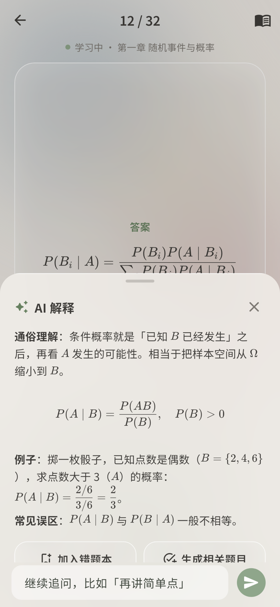
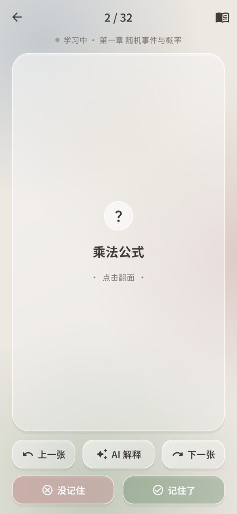
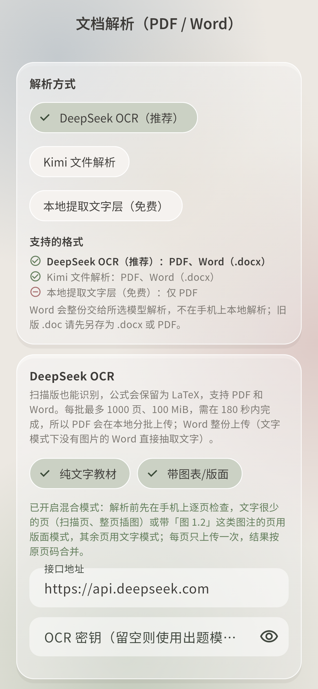

# AI 闪卡刷题

*AI Flashcards — turn your PDF / Word textbooks into flashcards and quizzes with AI (Android, Flutter).*

把 PDF / Word 教材交给 AI，自动生成闪卡和练习题，用 FSRS 间隔重复算法安排复习。界面采用莫兰迪配色 + 玻璃质感。

<p>


</p>
<p>




</p>

## 功能
- **按项目管理**：新建项目（如「概率论」）→ 上传 PDF 或 Word（.docx / .doc，可一次多选）→ AI 生成闪卡和题目，按章节浏览，每条都带解析和出处页码，可点回原文核对。
- **PDF 解析**：默认 DeepSeek OCR，扫描版也能识别；支持**混合模式**（文字模式 + 版面模式同时勾选，App 在本地逐页判断，图表页用版面模式、其余用文字模式，每页只上传一次）。也可用 Kimi 文件解析或本地提取文字层。大文件自动分批，失败可重试，结果本地缓存不重复花钱。
- **Word 文档（.docx / .doc）**：整份交给设置里的解析模型——DeepSeek OCR 和 Kimi 都支持 Word，不在手机上本地解析。按标题切成小节，按章节生成，出处显示标题名而不是页码。「本地提取」只支持 PDF，上传 Word 会提示切换模型或另存为 PDF。
- **生成选项**：范围（整份/章节/页码）、数量、题型（单选、多选、判断、填空、简答、计算）、难度、侧重点、自定义要求；可存模板、设项目默认；高级设置可修改全部提示词。
- **闪卡复习**：点按翻面，左右滑动评分；FSRS 算法安排复习；上一张 / 下一张回看；进度随时保存，被系统杀掉也能恢复。
- **测验**：客观题自动判分，简答/计算题由 AI 批改打分；答完显示解析；可回看上一题。
- **AI 解释**：闪卡和题目上都有，半屏面板结合原文讲解并举例，可追问，结果缓存。
- **错题本**：答错自动收录，可标记「不确定」「AI 出错了」，一键针对知识点出新题，连续答对 3 次自动移出；支持按项目筛选、跨项目重做。
- **数学公式**：所有地方用真正的 LaTeX 排版引擎显示，像教材一样。
- **自带 API 密钥**：兼容 OpenAI 格式的任意服务（默认 DeepSeek，也可用通义千问、Kimi 等）。

## 安装
到 [Releases](../../releases) 下载 APK：
- 绝大多数手机选 **`ai-flashcards-*-arm64-v8a.apk`**
- 很老的 32 位手机选 `armeabi-v7a`，模拟器选 `x86_64`

下载后点开安装（需允许“安装未知来源应用”）。

## 配置 API 密钥
1. 到 [DeepSeek 开放平台](https://platform.deepseek.com/) 申请 API 密钥。
2. App → **我的 → 出题模型**：填入密钥（接口地址默认 `https://api.deepseek.com`，模型默认 `deepseek-flash`，可切换），点「测试连接」。
3. **我的 → 文档解析（PDF / Word）**：选择解析方式和模式；OCR 密钥留空时使用上面的密钥。

## 隐私
- 所有资料、解析结果、卡片和错题只保存在手机本地，没有任何服务器。
- API 密钥保存在系统安全存储（Android Keystore）中。
- PDF / Word 内容只会发送给你在设置里配置的 API 服务商（如 DeepSeek / Kimi）；选择「本地提取」则完全不联网。

## 从源码构建
需要 Flutter 3.50.1（stable）、Android SDK、JDK 17。
```bash
flutter pub get
flutter test
flutter build apk --release --split-per-abi
```
发布签名：在 `android/key.properties`（或环境变量 `AI_FLASHCARDS_KEY_PROPERTIES` 指向的文件）里填写 `storeFile / storePassword / keyAlias / keyPassword`；没有该文件时自动使用 debug 签名。

界面截图由测试生成：`flutter test test/screenshots_test.dart --update-goldens`。

## 已知限制
- 真实 API 调用（OCR、出题、批改）在开发中只做了模拟测试，请以实际使用为准。
- 混合模式靠文字层判断页面类型（字数少或有「图 x.x」图注 → 版面模式），整本扫描版会全部使用版面模式。
- Kimi 解析按批返回整段文字，页码精度较低。
- 章节识别基于「第X章」「1.2 小节」等标题格式，特殊排版可能识别不准。
- 目前只有 Android 版；暂不支持网盘同步。

## 许可
[MIT](LICENSE)。测试用字体 Noto Sans SC 采用 [SIL OFL 1.1](test/fonts/OFL.txt)。
