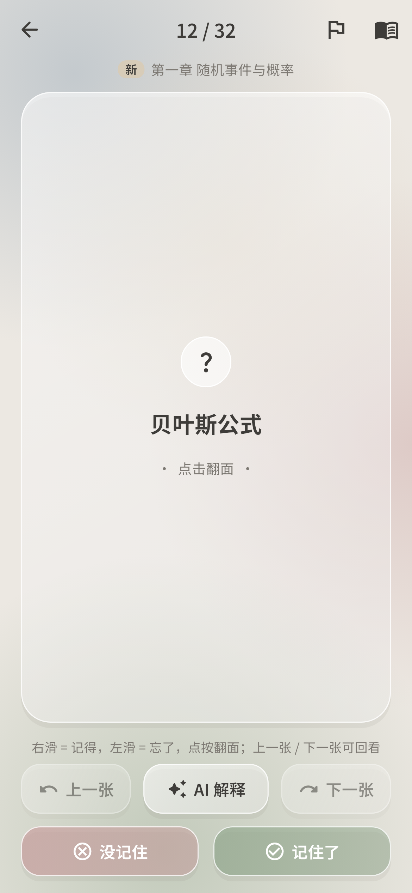
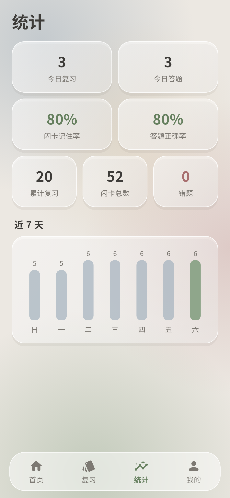

<div align="center">


# 闪卡刷题

**把教材变成闪卡和练习题，用科学的间隔重复记住它。**

[](https://github.com/HenryHam88/ai-flashcards/releases/latest)
[](https://github.com/HenryHam88/ai-flashcards/releases)
[](LICENSE)
[](#下载)
[](https://flutter.dev)

**简体中文** | [English](README.en.md)

</div>

闪卡刷题是一款开源的 Android 学习应用。导入 PDF 或 Word 教材后，AI 会提炼知识点，生成闪卡和多种题型的练习题，并用 FSRS 算法安排复习。公式按教材排版显示，所有学习数据只保存在你的手机上。

## 截图

<table>
  <tr>
    <td align="center"><br><sub>项目首页</sub></td>
    <td align="center"><br><sub>闪卡复习</sub></td>
    <td align="center"><br><sub>测验</sub></td>
    <td align="center"><br><sub>AI 解释</sub></td>
  </tr>
  <tr>
    <td align="center"><br><sub>学习统计</sub></td>
    <td align="center"><br><sub>错题本</sub></td>
    <td align="center"><br><sub>资料管理</sub></td>
    <td align="center"><br><sub>解析设置</sub></td>
  </tr>
</table>

## 功能

**资料与生成**
- 支持 PDF 和 Word（.docx / .doc），可批量导入，每份资料单独显示进度
- 扫描版 PDF 也能识别，公式保留为 LaTeX
- 按整份、章节或页码范围生成；可设置数量、题型、难度和侧重点
- 题型：单选、多选、判断、填空、简答、计算
- 每张卡片和每道题都标注出处，一键查看原文

**复习与测验**
- FSRS 间隔重复调度，滑动评分，支持上一张 / 下一张回看
- 客观题自动判分，简答题和计算题由 AI 批改
- AI 解释：结合原文讲解、举例，可以继续追问
- 错题本：自动收录，按项目筛选，针对薄弱知识点再出新题

**体验**
- 完整的 LaTeX 公式排版与 Markdown 格式
- 莫兰迪配色、玻璃质感界面
- 复习进度自动保存，切出应用后可继续

## 下载

从 [Releases](https://github.com/HenryHam88/ai-flashcards/releases/latest) 下载最新版本：

| 安装包 | 适用设备 |
| --- | --- |
| `ai-flashcards-<版本>-arm64-v8a.apk` | **绝大多数手机，推荐** |
| `ai-flashcards-<版本>-armeabi-v7a.apk` | 较老的 32 位设备 |
| `ai-flashcards-<版本>-x86_64.apk` | 模拟器、x86 平板 |

需要 Android 7.0 及以上。首次安装时需允许「安装未知来源应用」。新版本可直接覆盖安装，数据会保留。

<details>
<summary>签名证书指纹（用于校验 APK）</summary>

```
SHA-256: f5:ec:04:9f:25:ef:21:59:36:28:23:59:4a:08:49:46:f5:66:6d:cc:54:35:19:b9:9a:e1:d0:2f:be:a1:0d:59
```

可用 `apksigner verify --print-certs <apk>` 核对。
</details>

## 快速开始

1. 在 [DeepSeek 开放平台](https://platform.deepseek.com/) 创建 API Key。
2. 打开应用，进入 **我的 → 出题模型**，填入 API Key，点击「测试连接」。
3. 新建项目，上传教材，解析完成后点击「生成」。

> [!TIP]
> 出题模型兼容任何 OpenAI 格式的接口，也可以换成通义千问、Kimi 等服务。

## 支持的解析方式

在 **我的 → 文档解析（PDF / Word）** 中选择：

| 解析方式 | PDF | Word（.docx / .doc） | 扫描版 | 费用 |
| :-- | :-: | :-: | :-: | :-- |
| DeepSeek OCR（默认） | ✓ | ✓ | ✓ | 按页计费 |
| Kimi 文件解析 | ✓ | ✓ | — | 目前免费 |
| 本地提取文字层 | ✓ | — | — | 免费，离线 |

## 隐私

- 资料、卡片、错题和学习记录只保存在本机，项目没有任何服务器。
- API Key 存放在系统安全存储（Android Keystore）中。
- 文档内容只会发送给你配置的服务商；选择「本地提取」时完全不联网。

## 常见问题

<details>
<summary><b>需要付费吗？</b></summary>

应用本身免费开源。生成和解析会调用你自己的 API Key，费用由对应服务商收取；解析结果和生成内容会缓存，不会重复计费。
</details>

<details>
<summary><b>上传 Word 后提示「当前解析模型不支持 Word」？</b></summary>

「本地提取」只能读取 PDF。请在解析设置里切换到 DeepSeek OCR 或 Kimi，或将文档另存为 PDF。
</details>

<details>
<summary><b>公式显示不正常怎么办？</b></summary>

可以在该卡片的「AI 解释」中让模型重新整理，或在测验中标记「AI 出错了」。
</details>

## 已知问题

- 生成与批改质量取决于所选模型，重要内容请对照原文核对。
- 使用 Kimi 解析 PDF 时，出处页码可能不够精确。
- 章节识别依赖「第 X 章」「1.2」这类常见标题格式，排版特殊的教材可能识别不准。
- 目前仅支持 Android，暂不支持多设备同步。

## 路线图

- [x] PDF / Word 解析与 AI 生成
- [x] FSRS 复习、测验与错题本
- [ ] 云端同步（WebDAV）
- [ ] 网页版
- [ ] iOS 版

欢迎在 [Issues](https://github.com/HenryHam88/ai-flashcards/issues) 中提出建议。

## 从源码构建

环境要求：Flutter 3.50（stable）、Android SDK、JDK 17。

```bash
git clone https://github.com/HenryHam88/ai-flashcards.git
cd ai-flashcards
flutter pub get
flutter test
flutter build apk --release --split-per-abi
```

发布签名从 `android/key.properties`（或环境变量 `AI_FLASHCARDS_KEY_PROPERTIES` 指定的文件）读取，未配置时使用 debug 签名。

## 参与贡献

欢迎提交 Issue 和 Pull Request，详见 [CONTRIBUTING.md](CONTRIBUTING.md)。版本变更记录见 [CHANGELOG.md](CHANGELOG.md)。

## 许可证

本项目基于 [MIT License](LICENSE) 开源。测试所用字体 Noto Sans SC 遵循 [SIL Open Font License 1.1](test/fonts/OFL.txt)。
